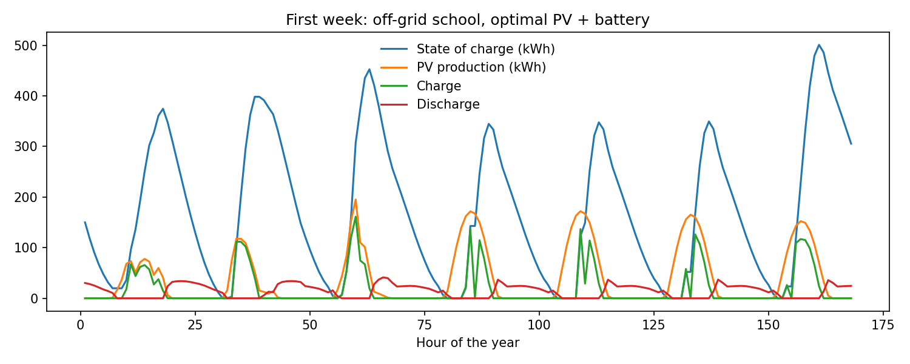
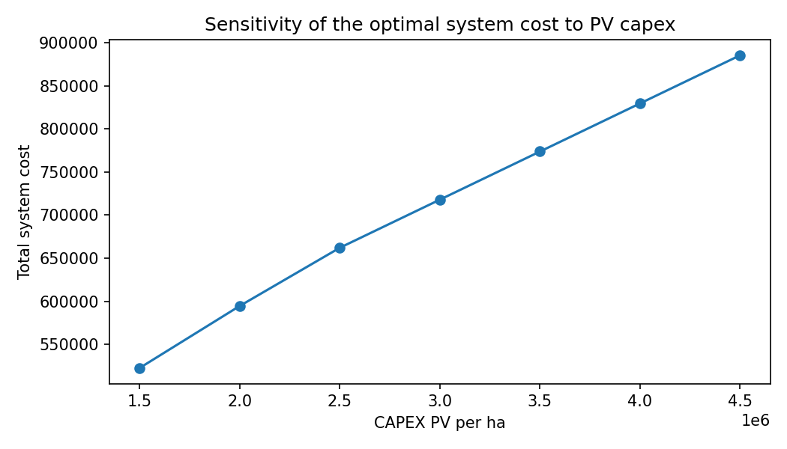

# Off-grid PV + battery sizing (Pyomo)

A compact Pyomo model that sizes the PV array and battery of a stand-alone system to meet an hourly demand at least cost. The demand is a school in Iringa, Tanzania, over a full year. It started as a master's course exercise and is kept as a minimal, readable template for sizing problems.

> **ES:** Modelo mínimo en Pyomo que dimensiona PV y batería para un sistema aislado (escuela en Iringa, Tanzania) al menor costo, con análisis de sensibilidad del CAPEX solar.



## Model

- **Decisions:**
  - PV area (ha)
  - battery energy capacity (kWh)
  - hourly PV-to-load, charge, discharge and curtailment
- **Constraints:**
  - hourly energy balance
  - PV output = area × irradiance × efficiency
  - state-of-charge dynamics with charge/discharge efficiencies
  - state of charge ≤ capacity
- **Objective:** minimise PV capex + storage capex.
- **Sensitivity:** the PV capex parameter is `mutable`, so the model is re-solved over a range of values without being rebuilt.

**Result** (input file as shipped): about 0.11 ha of PV and about 1.5 MWh of storage. Storage drives the cost, because the battery has to carry the load through every hour without sun. The total system cost rises roughly linearly with PV capex.



## Run it

```bash
pip install pyomo highspy pandas openpyxl matplotlib
python Pyomo_Optimization_Example.py     # figures and Excel output -> results/
```

Inputs (technical data, irradiance, demand, economics) live in `input/input_file.xlsx`.

## Where this went next

The same structure (sizing variables + hourly dispatch + an economic objective) scales up in:
- [North-Sea-Energy-Hub-Optimisation](https://github.com/schiped/North-Sea-Energy-Hub-Optimisation): offshore wind, floating PV, batteries and hydrogen, maximising NPV.
- [hybrid-pv-bess-mater](https://github.com/schiped/hybrid-pv-bess-mater): a utility-scale PV + BESS hybrid in Argentina behind a grid export limit.
